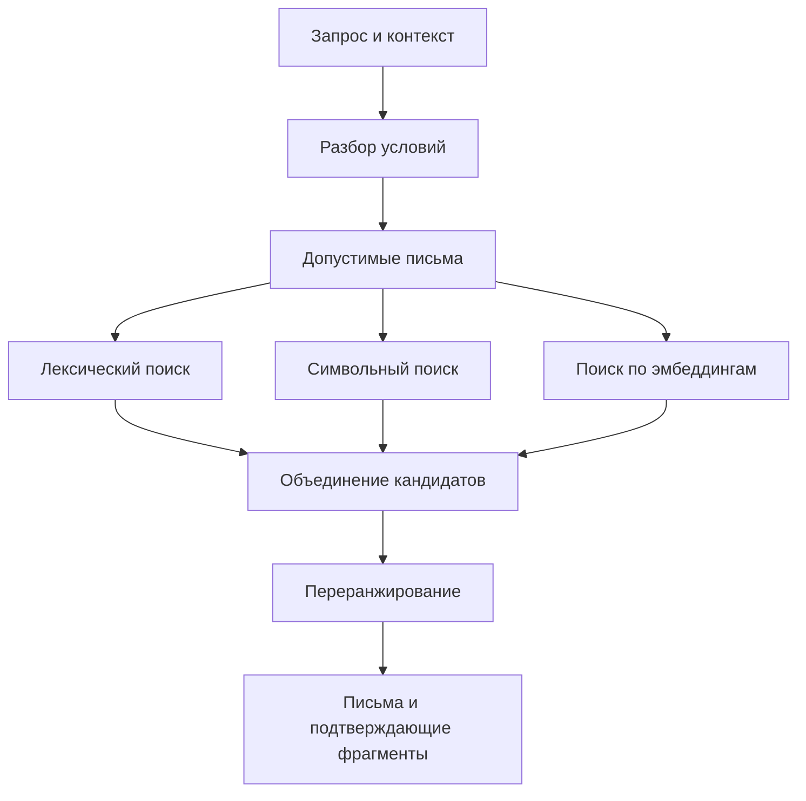

# VK: «Умный поиск в Почте». Анализ задачи, данных и возможных решений

Дата составления: 21 ноября 2026 года.

Документ объединяет результаты изучения условия, аудит предоставленных файлов, локальный эксперимент с поиском, обнаруженные особенности разметки, риски обобщения на private и идеи реализации. Это рабочая техническая записка для команды хакатона.

## Как читать документ

- **Правило**: явно указано в условии или README.
- **Наблюдение**: непосредственно проверено в предоставленных файлах.
- **Эксперимент**: результат конкретного локального алгоритма с описанными настройками.
- **Гипотеза**: возможное объяснение или сценарий private; подтверждения пока нет.
- **Рекомендация**: предложенное инженерное решение, которое ещё нужно проверить.

Намеренность обнаруженных «ловушек» не установлена. Узость dev может объясняться способом его сборки. Состав приватного бенчмарка неизвестен. Архитектуру следует проверять на существенно более разнообразных запросах, чем публичные.

Источники далее обозначены как **TASK**, **README**, **D**, **Q**, **R**, **MANIFEST** и **EXP**. Их описание, контрольные суммы и внешние ссылки приведены в разделах 3 и 18. Документ не требует открытия предыдущих сообщений чата.

## 1. Основные выводы

1. В корпусе 16 376 писем из 12 ящиков. Публичная проверка содержит 99 запросов, относящихся к 7 ящикам, и 565 положительных пар запрос-письмо.
2. Все 99 запросов ограничивают поиск одним днём. Во всех случаях запрошенный день совпадает с предыдущим днём относительно `query_date`, включая явно записанные даты.
3. После удаления «Найди»/«Покажи» и временного суффикса остаются 12 тематических формулировок.
4. Для 49 из 99 запросов множество писем нужного ящика за нужный день точно совпадает с полным множеством размеченных релевантных документов. Половина dev практически не проверяет различение содержания.
5. Символьный TF-IDF с корректным фильтром дня получил `nDCG@10 = 0.978024` и `Recall@10 = 0.929218`. Это диагностический baseline, а не доказательство готовности универсального поиска.
6. Из 180 писем с точной извлечённой темой «Покупатель отменил заказ» у 179 неизвестна дата получения. Удаление всех писем с `doc_dt = null` почти уничтожит эту категорию, не ухудшив текущий dev.
7. Номера и имена после синтетического преобразования неоднозначны. Совпадение номера полезно для поиска, но его недостаточно для дедупликации и построения истории объекта.
8. Сложные различия в тексте связаны с объектом, действием, стадией и модальностью: действие выполнено, разрешено, ожидается или только возможно при условии.
9. Публичный набор не проверяет пустую выдачу, широкий поиск без даты и значительную часть тем корпуса. Нужен отдельный вручную проверенный набор.
10. Предлагаемая основа решения: корректная видимость писем, разбор условий запроса, гибридный поиск, небольшой reranker и проверка качества вместе с p99. Нейросетевые варианты и серверный p99 пока не измерялись.

Источники: D, Q, R, README, EXP; собственные подсчёты и интерпретация.

## 2. Условия задачи и ограничения

Источник: TASK; уточнения формата данных из README.

| Пункт | Что известно |
| --- | --- |
| Продукт | Веб-сервис для просмотра писем и умного поиска по предоставленному корпусу |
| Интерфейс | Небольшой работающий прототип почты |
| Основной трек | Качество и скорость поискового движка; возможности должны выходить за рамки простого полнотекстового поиска |
| Пользовательские сценарии | Команда выбирает и обосновывает их самостоятельно |
| Оценка | Организаторы запускают решения на закрытом бенчмарке |
| Вычислительные ресурсы | В условии не ограничены |
| Скорость | p99 строго меньше 1 секунды |
| Что входит во время | Обработка запроса сервером, поиск, ранжирование, подготовка выдачи |
| Что не входит | Сеть между браузером и сервером, отрисовка интерфейса |
| Нарушение p99 | Штраф, а не автоматическая дисквалификация |
| Модельные ограничения | API моделей и модели свыше 3 млрд параметров на retrieval/reranking приводят к снижению оценки |
| Вне поискового движка | В условии сказано, что за API и большие модели вне движка штрафы не начисляются |
| Сдача | Репозиторий с исходниками и инструкцией запуска, работающая веб-демонстрация, защита |
| Развёртывание | Localhost разрешён; работающий сервис в интернете даёт 1 дополнительный балл |
| Дополнительный трек | Необязательные полезные функции почты; точные бонусы и критерии уточняются |

В приложенной постановке ещё не зафиксированы окончательная метрика качества, K, нагрузка, правила прогрева и кэширования, размеры штрафов и подробная методика замера. Предложенные README Recall@K, nDCG@K и MRR@K являются ориентирами для локальной проверки; их нельзя автоматически считать окончательной формулой оценки.

Офлайн-предвычисление эмбеддингов не следует считать автоматическим освобождением модели от ограничений retrieval. Границы применения ограничений к подготовке индекса, генерации обучающих данных и вспомогательным моделям лучше уточнить.

## 3. Файлы, формат и целостность

### 3.1. Состав полученного набора

| Обозначение | Файл | Содержание |
| --- | --- | --- |
| TASK | `vk-mail-search(1).pdf` | Условие хакатона, 1 страница |
| README | `README(1).md` | Схемы, правила дат и рекомендации по оценке |
| MANIFEST | `manifest.json` | Количества строк и SHA-256 |
| D | `documents.jsonl` | Письма |
| Q | `queries_dev.jsonl` | Публичные запросы |
| R | `qrels_dev.jsonl` | Положительные пары запрос-письмо |
| Дубликат R | `qrels_dev(1).jsonl` | Полностью совпадает с `qrels_dev.jsonl` побайтово |
| EXP | Локальный диагностический эксперимент | Методика и воспроизводящий код включены в этот документ |

`qrels_dev(1).jsonl` не содержит дополнительной разметки. Объединять два qrels с удвоением строк не нужно.

### 3.2. Поля

| Объект | Поле | Значение |
| --- | --- | --- |
| Письмо | `doc_id` | Идентификатор документа |
| Письмо | `synthetic_user` | Почтовый ящик |
| Письмо | `doc` | Полный текст, иногда с текстовыми заголовками |
| Письмо | `doc_dt` | Дата получения `YYYY-MM-DD` или `null` |
| Запрос | `query_id` | Идентификатор запроса |
| Запрос | `synthetic_user` | Ящик, в котором выполняется поиск |
| Запрос | `query` | Текст запроса |
| Запрос | `query_date` | Дата запроса, точка отсчёта для относительных дат |
| Разметка | `query_id`, `doc_id` | Пара запрос-письмо |
| Разметка | `relevance` | 1 для размеченного релевантного письма |

Формат JSONL, UTF-8, один JSON-объект на строку. Внешние структурированные поля отправителя, темы, вложений и цепочки переписки отсутствуют. Их возможное извлечение из `doc` является дополнительной обработкой и не гарантирует полноты.

### 3.3. Контрольные суммы

Все четыре контрольные суммы совпали с MANIFEST. Для имени `README.md` из манифеста проверялся приложенный `README(1).md`.

| Имя в MANIFEST | SHA-256 |
| --- | --- |
| `README.md` | `237ecc95e3db0e959edb073acd4ddf287248524e9c725f6897921d4a19cddb0b` |
| `documents.jsonl` | `06feb4791a52faeb777f1a8d4c22d99efd26a279943a19bdfbd0b14bc9c8daa5` |
| `qrels_dev.jsonl` | `826362ae5592d58b3bb1cd382103dc0aef151cf014025258f0cddba0fefa0dd4` |
| `queries_dev.jsonl` | `7a5b587ee7361ca2e35e1929cbbfdcc3154b4302b6fb830ae1c41846518d6017` |

Точных дублей `doc_id`, полных текстов писем, `query_id` и пар `(query_id, doc_id)` не обнаружено. Уникальность полных текстов не означает разнообразия шаблонов.

## 4. Статистика корпуса

Источник: D; собственные подсчёты. Для связи с запросами также использован Q.

### 4.1. Общая статистика

| Показатель | Значение |
| --- | ---: |
| Писем | 16 376 |
| Ящиков | 12 |
| Ящиков с публичными запросами | 7 |
| Писем в пяти ящиках без публичных запросов | 6427 |
| Доля этих писем | около 39,25% |
| Писем с неизвестной датой | 433 |
| Доля неизвестных дат | около 2,64% |
| Медианная длина письма | 656 символов |
| 95-й процентиль длины | 1054 символа |
| 99-й процентиль длины | 1468,25 символа |
| Максимальная длина | 15 724 символа |

Процентили вычислены с линейной интерполяцией. Это длины Unicode-строк после JSON-парсинга, не байты и не токены модели.

Большинство писем короткие. Массовое разбиение каждого письма на чанки не выглядит первым необходимым шагом. Для редких длинных писем можно предусмотреть отдельную обработку, сохраняя `doc_id` единицей выдачи.

### 4.2. Распределение по ящикам

| `synthetic_user` | Писем | Dev-запросов |
| --- | ---: | ---: |
| `box-12259a301ee2` | 2401 | 0 |
| `box-2d28af4e4602` | 1784 | 22 |
| `box-f9410417c091` | 3010 | 10 |
| `box-84dd8d9560e6` | 902 | 2 |
| `box-fad2b057e79a` | 1955 | 0 |
| `box-dfac33a7123c` | 1094 | 28 |
| `box-84bd433469cb` | 720 | 25 |
| `box-90560850fd8e` | 713 | 0 |
| `box-a971835ab404` | 980 | 11 |
| `box-a55c522c6949` | 561 | 0 |
| `box-fda57474896e` | 797 | 0 |
| `box-d7961fc39a68` | 1459 | 1 |
| **Всего** | **16 376** | **99** |

В ящиках без запросов присутствуют штрафы, счета, медицинские сообщения, ошибки баз данных, остатки на складах и новые заказы. Публичный score непосредственно не проверяет качество поиска в этих ящиках.

### 4.3. Заголовки и маркеры синтетического преобразования

Заголовки искались по началу строки без учёта регистра. Наличие слова где-то внутри тела не считалось наличием заголовка.

| Наблюдение | Писем |
| --- | ---: |
| Есть строка `ОТ:` | 7324 |
| Есть строка `ТЕМА:` | 13 187 |
| Есть строка `ТЕКСТ ПИСЬМА:` | 8233 |
| Нет отдельной строки `ТЕМА:` | 3189 |
| Есть точная подстрока `FULL_NAME` | 40 |
| Есть точная подстрока `EMAIL` | 477 |
| Есть точная подстрока `NUMS` | 738 |
| Есть точная подстрока `FROM_USER` | 175 |
| Есть реальные переводы строк | 13 632 |
| Есть буквальные два символа `\n` после JSON-парсинга | 0 |

Маркерные подстроки считались с учётом регистра. Число 169, встречавшееся при промежуточном анализе `FROM_USER`, относилось к конкретному извлечённому значению заголовка `ОТ: FROM_USER`; число 175 относится к подстроке во всём письме.

Видимые `\n` в JSON или отладочном представлении строк не означают повреждение переводов строк. Отдельная гипотеза о массовых буквальных escape-последовательностях не подтвердилась.

### 4.4. Повторяющиеся темы и фрагменты

| Точная извлечённая тема или фраза | Писем |
| --- | ---: |
| Тема «Есть новый заказ» | 5054 |
| Тема «Вам выставлен новый штраф» | 892 |
| Тема «Счёт на оплату» | 804 |
| Тема «Успешная оплата» | 704 |
| Тема «Покупатель отменил заказ» | 180 |
| Из предыдущих 180: неизвестна дата | 179 |
| Буквальная фраза «Если не обработать» | 2918 |

Шаблонные рекламные и инструктивные окончания писем повторяются. Одинаковая тема и похожее тело не являются основанием удалять письма: разные документы могут быть самостоятельными релевантными результатами.

## 5. Устройство публичного бенчмарка

Источники: D, Q, R; собственные подсчёты.

### 5.1. Запросы

Все 99 запросов ограничивают дату получения одним днём:

- 26 используют слово «вчера»;
- 73 указывают календарную дату явно;
- все 99 запрашивают день `query_date - 1 день`.

Последнее является свойством конкретного dev. В решении нужно разбирать фактически заданную дату, а не всегда подставлять предыдущий день.

### 5.2. Двенадцать тематических формулировок

Шаблон выделялся удалением начального «Найди»/«Покажи» и суффикса `, полученные ...`.

| Смысл запроса | Количество |
| --- | ---: |
| Сбои модуля электронных рецептов | 28 |
| Получение новых заказов | 20 |
| Прибытие автомашин | 10 |
| Отклонённые платежи | 9 |
| Заявки покупателей на возврат | 9 |
| Создание автовизитов для вывоза контейнеров | 7 |
| Электронные чеки | 5 |
| Выгрузка контейнеров | 4 |
| Завершение досмотра контейнеров | 2 |
| Погрузка контейнеров | 2 |
| Успешная оплата | 2 |
| Приёмка | 1 |
| **Всего** | **99** |

### 5.3. Сила фильтра по ящику и дате

Для 49 запросов множество документов правильного ящика за запрошенный день точно равно полному размеченному множеству. Среди них все 28 запросов про сбои электронных рецептов.

| Множество кандидатов на запрос | Минимум | Медиана | Среднее | Максимум |
| --- | ---: | ---: | ---: | ---: |
| Свой ящик; известная дата не позже `query_date`; неизвестная дата допускается | 2 | 539 | около 648,1 | 3002 |
| Дополнительно точный день получения | 1 | 7 | 33,81818 | 262 |
| Размеченные релевантные документы | 1 | 2 | около 5,7 | 65 |

Эта структура делает общий dev score оптимистичным индикатором универсальной семантики. Рекомендуется отдельно смотреть 49 простых запросов и оставшиеся 50.

### 5.4. Проверка согласованности положительных пар

Для всех 565 положительных пар:

- `synthetic_user` письма совпадает с ящиком запроса;
- `doc_dt` совпадает с запрошенным днём;
- `doc_dt` известна;
- письмо не находится в будущем относительно `query_date`.

Это проверка внутренней согласованности имеющихся положительных пар. Она не доказывает полноту разметки всех подходящих писем.

## 6. Разметка и метрики

### 6.1. Что означает отсутствие пары в qrels

По README любая пара без строки в qrels получает ноль при вычислении метрик. Это однозначное правило оценки.

При обучении такая пара не обязательно является надёжно проверенным отрицательным примером. В особенности стоит проверять вручную близкие по смыслу документы, которые модель оценивает высоко.

### 6.2. Подозрительный пример разметки

Запрос `H-cf13f62178c5b81140c8`:

> Покажи уведомления о завершении досмотра контейнеров, полученные вчера.

Ящик: `box-84bd433469cb`. `query_date = 2028-09-19`, запрошенный день `2028-09-18`.

В qrels присутствуют:

- `L-42c39168fe1de2e7dc06`;
- `L-9e721150de9da54b46a1`;
- `L-c2a5f55276af7e9b3dad`.

Документ `L-9df7d161164c1b561c24` находится в том же ящике, имеет `doc_dt = 2028-09-18`, упоминает контейнер в теме и содержит фрагмент «прошёл досмотр 18.09.2028 в 13:42:40», но в qrels для этого запроса отсутствует. Его текст также повреждён синтетической заменой сущностей.

**Статус вывода: подозрение на неполноту или неоднозначность.** Это не доказанная ошибка организаторов. Может существовать более тонкий критерий релевантности. Для локальной метрики документ должен получать ноль согласно README.

### 6.3. Сколько положительных ответов бывает

| Показатель | Значение |
| --- | ---: |
| Запросов с единственным релевантным письмом | 42 |
| Запросов с более чем 10 релевантными письмами | 15 |
| Максимум релевантных писем у одного запроса | 65 |
| Запросов без положительных писем | 0 |

Dev не проверяет поведение при отсутствии ответа. Всегда возвращать top-K достаточно для получения неплохого score, но такое поведение может быть неудобным в продукте.

### 6.4. Почему Recall@10 не может достичь 1

При `r` релевантных письмах идеальный Recall@K равен `min(K, r) / r`. После усреднения по запросам получаются потолки:

| K | Максимально возможный средний Recall@K |
| --- | ---: |
| 5 | 0.862982 |
| 10 | 0.937564 |
| 20 | 0.980326 |
| 50 | 0.996751 |

Поэтому Recall@10 около 0,929 здесь уже близок к достижимому максимуму. Для стандартного nDCG@10 идеальная выдача получает 1. MRR@10 в эксперименте отдельно усреднялся только по 42 запросам с единственным релевантным документом.

## 7. Каталог обнаруженных рисков

Ниже наблюдения из D, Q, R и следующие из них инженерные риски. Предположения о том, что именно попадёт в private, не являются установленными фактами.

### 7.1. Удаление неизвестных дат уничтожает часть тем

У 179 из 180 писем с точной темой «Покупатель отменил заказ» дата неизвестна. Пример: `L-00b51fdb5a6bb26437c2`, тема «Покупатель отменил заказ», `doc_dt = null`.

Такое письмо может отвечать запросу «Покажи отменённые покупателями заказы» без ограничения времени. Текущий dev не накажет за его удаление.

Рекомендация: хранить признак неизвестности; сохранять эти письма для запросов без временного ограничения. Для строгого условия по дате неизвестность обрабатывать явно. Не назначать сегодняшнюю дату, эпоху Unix или первую дату из тела как достоверный `doc_dt`.

### 7.2. Условное действие принимается за состоявшееся

В новом заказе `L-00338c9761d11410df5d` написано «Если не обработать заказ, его отменят». Это возможная будущая отмена.

В письме о возврате `L-f9284d4d5cc0810ceae8` обсуждаются одобрение, отказ, компенсация и автоматическое решение как варианты развития ситуации.

Риск: поиск отмен, отказов и завершённых возвратов поднимет инструкции о возможных действиях. Это проблема и лексического поиска, и embeddings, и простого классификатора по словам.

Рекомендация: различать утверждение, условие, рекомендацию, разрешение, ожидание и прошлый статус. Проверять контрастные пары запросов и документов.

### 7.3. Близкие стадии одного процесса смешиваются

Примеры различий:

| Искомое событие | Похожее, но другое событие |
| --- | --- |
| Покупатель подал новую заявку на возврат | У существующего возврата изменился статус |
| Контейнер погружен | Таможня разрешила погрузку |
| Автомашина прибыла | Ожидается прибытие контейнера |
| Платёж отклонён | Платёж одобрен |
| Получен электронный чек | Пришло уведомление об оплате |
| Досмотр завершён | Контейнер назначен на досмотр |

Предметная область и большая часть слов совпадают. Нужна точность по объекту, действию и стадии.

### 7.4. Дата получения, дата события и срок действия смешиваются

В документе `L-0725658860585da4ff39`:

- `doc_dt = 2028-09-07`;
- в теле создан автовизит `07.09.2028`;
- в теме встречается `дата12февраля3254`.

В `L-f9284d4d5cc0810ceae8` письмо получено 18 ноября 2027 года, а решение по возврату требуется до 19 ноября.

Рекомендация: интерпретировать временное условие вместе с его ролью. «Полученные в декабре» ограничивает `doc_dt`; «билеты на поездку в декабре» может относиться к дате события. Относительные периоды считать от `query_date`.

### 7.5. Письма из будущего и чужого ящика попадают в выдачу

По README доступность задаётся ящиком и датой запроса. Нельзя искать по всему корпусу, игнорируя эти поля.

Если сначала получить маленький глобальный top-K, а потом убрать чужие письма, правильные документы нужного ящика могут вообще не попасть в кандидаты. Лучше учитывать допустимое множество до отбора top-K или внутри поиска.

Рекомендация: обязательная изоляция ящика; исключение известного `doc_dt > query_date`; применение той же логики ко всем каналам поиска и к кэшу.

### 7.6. Повторяющийся синтетический номер не является надёжной идентичностью объекта

`SYN-9419e659f0` встречается в 138 письмах. В ящике `box-f9410417c091` за 27 ноября 2027 года таких писем семь.

| Документ | Описание | Сумма |
| --- | --- | ---: |
| `L-39992147c9222fbb312b` | Радиатор отопителя | 6253.06 RUB |
| `L-3c48718763b1846e6d52` | Противоскрипные пластины | 2977.92 RUB |
| `L-6a6ff6f87e07a70f65e2` | Адаптер щётки | 487.32 RUB |
| `L-cb9cd560655a6a540d4d` | Сальник привода | 5130.27 RUB |

Причина неоднозначности без исходных данных неизвестна. Возможные коллизии псевдонимизации являются гипотезой.

Рекомендация: использовать точное совпадение номера как сигнал релевантности. Для склейки, дедупликации и вычисления последнего статуса одного номера недостаточно. Сохранять документы с разными `doc_id`.

### 7.7. Имена и названия занимают неожиданные смысловые роли

Встречаются конструкции «Радиатор отопителя, для Тамара Юльевна Карпова 3...» и фрагменты, где вместо обозначения контейнера стоит имя человека. Необработанные `FULL_NAME`, `EMAIL`, `NUMS` также встречаются в корпусе.

Риск: NER ошибётся в роли сущности, а модель начнёт восстанавливать правдоподобный, но отсутствующий смысл. Знания об исходном бренде или человеке не следует подставлять вместо текста.

Рекомендация: хранить исходную строку, позицию и уверенность извлечения; использовать контекст действия; не строить жёсткие связи только по имени.

### 7.8. Жёсткий парсер заголовков теряет письма

Заголовки необязательны, различаются регистром и оформлением. У 3189 писем нет отдельной строки `ТЕМА:`. Слово «Отправитель» в чеке может обозначать участника расчёта, а не автора email.

Рекомендация: сохранять полное тело и делать извлечённые поля необязательными. Ошибка разбора заголовков не должна исключать документ из индекса.

### 7.9. Морфология и синонимы требуют разных механизмов

«Прибытии автомашин» и «Автомашина прибыла» плохо сопоставляются точным словарным поиском без нормализации. Символьные n-граммы помогают с пересекающимися частями слов, но не гарантируют сопоставление «автомашина» и «автомобиль».

Нормализация `ё` в `е`, регистра и пробелов полезна как отдельный канал. Оригинал сохраняется для отображения. Нельзя уничтожать номера и отрицания агрессивным удалением токенов. В диагностическом BM25 использовались упрощённые стоп-слова, включая «не»; такой список не следует переносить в полноценный поиск с отрицаниями.

### 7.10. Шаблонный хвост вытесняет главное содержание

Уведомления о заказах могут содержать длинные абзацы про рекламу, отзывы, скидку и настройки. Эти фрагменты повторяются и не обязательно определяют предмет письма.

Рекомендация: проверять раздельные представления темы, содержательной части и полного текста. Удалять шаблонные фрагменты следует осторожно: в инструкциях также встречаются реальные сроки и действия, которые пользователь может искать.

### 7.11. Случайное разбиение создаёт оптимистичную проверку

Двенадцать запросных шаблонов и тысячи похожих писем легко попадают одновременно в train и validation. Повторяющиеся темы не обеспечивают независимость примеров.

Рекомендация: при обучении и подборе настроек разделять семейства запросов, шаблоны писем и по возможности ящики. Отдельно проверять новые намерения. Перефразирование старых двенадцати категорий проверяет устойчивость формулировок, но не полноту набора намерений.

### 7.12. Все запросы имеют ответ, а часть имеет много ответов

Dev не проверяет отказ от уверенного ответа. Одновременно до 65 документов могут быть релевантны одному запросу.

Рекомендация: добавлять запросы с пустым ответом; отделять ранжирование от пользовательского порога уверенности; не схлопывать похожие релевантные письма в один результат без сохранения остальных `doc_id`.

### 7.13. Неразмеченные пары превращаются в ложные отрицательные примеры

Особенно опасно автоматически брать все высоко оценённые, но отсутствующие в qrels пары как уверенные hard negatives. Разметка может быть неоднозначной или неполной.

Рекомендация: проверять наиболее трудные пары вручную, фиксировать спорные примеры отдельно и сохранять официальное правило оценки.

### 7.14. Маленький набор после фильтра скрывает проблемы p99

Широкий запрос без даты может охватывать весь доступный ящик. Полный reranking каждого письма тогда намного дороже, чем reranking семи кандидатов.

Рекомендация: ограничивать дорогую обработку по результатам измерений; проверять большие ящики, длинные письма, отсутствие фильтра даты и конкурентную нагрузку. Соблюдение p99 пока не установлено.

## 8. Локальный эксперимент с поиском

Источник: EXP. Результаты получены на всех 99 публичных запросах. Это диагностический эксперимент без обучения на qrels и без подбора правил по конкретным правильным документам.

### 8.1. Общие условия

Для каждого запроса применялась обязательная видимость:

1. Только `synthetic_user` из запроса.
2. Документ с известной датой позже `query_date` исключается.
3. Неизвестная дата допускается в вариантах без ограничения конкретного дня.
4. В вариантах с точным днём требуется `doc_dt == parsed_date`; неизвестная дата не подтверждает такое условие.

Дата извлекалась из двух фактически встречающихся форм: «полученные вчера» и «полученные D <месяц> YYYY года». Явная дата разбиралась независимо от наблюдения, что она всегда совпадает со вчерашней.

IDF и словари вычислялись по полному предоставленному корпусу. После скоринга применялось допустимое множество кандидатов. Это не отдельный эксперимент с историческим построением индекса только по письмам, доступным на дату каждого запроса.

### 8.2. BM25

Настройки:

- lowercase;
- `ё` преобразуется в `е`;
- токены по регулярному выражению `[a-zа-я0-9]+`;
- небольшой фиксированный набор стоп-слов и названий месяцев;
- без лемматизации и без отдельного веса темы;
- `k1 = 1.2`, `b = 0.75`;
- IDF: `log(1 + (N - df + 0.5) / (df + 0.5))`;
- термины запроса учитываются по бинарному наличию;
- в текстовом запросе остаются числа даты и год.

Это простой baseline с точными словами. Результат не является оценкой предельных возможностей BM25 с качественным русским анализатором.

### 8.3. Символьный TF-IDF

Настройки `sklearn.feature_extraction.text.TfidfVectorizer`:

```python
analyzer='char_wb'
ngram_range=(3, 5)
min_df=2
max_features=160000
sublinear_tf=True
```

Остальные параметры стандартные, включая lowercase и L2-нормировку. Score равен скалярному произведению нормированных разреженных векторов. Для запроса использовался полный текст, включая инструктивную фразу и дату. В этом варианте отдельная замена `ё` на `е` не добавлялась.

### 8.4. Результаты

Все метрики усредняются по запросам. Релевантность бинарная. В последнем столбце используются только 42 запроса с одним положительным документом.

| Метод | Recall@5 | Recall@10 | Recall@20 | nDCG@10 | MRR@10, один положительный |
| --- | ---: | ---: | ---: | ---: | ---: |
| Только день, затем сортировка по `doc_id` | 0.572386 | 0.655863 | 0.728685 | 0.663316 | 0.801020 |
| Простой BM25 | 0.273880 | 0.399213 | 0.495189 | 0.254342 | 0.265731 |
| BM25 + день | 0.673779 | 0.770834 | 0.847559 | 0.762214 | 0.889881 |
| Символьный TF-IDF | 0.176782 | 0.310112 | 0.518007 | 0.196173 | 0.199065 |
| Символьный TF-IDF + день | **0.846315** | **0.929218** | **0.974204** | **0.978024** | **0.976190** |

Дополнительные проверки:

- У символьного TF-IDF с днём nDCG@10 идеален на 88 из 99 запросов с численным допуском `1e-12`. Прямое сравнение float `== 1` даёт 85; разница связана с арифметикой с плавающей точкой.
- На 49 запросах, где фильтр дня точно совпал с qrels, средний nDCG@10 равен 1.
- На оставшихся 50 запросах nDCG@10 этого варианта составляет примерно 0.956488.

### 8.5. Интерпретация и ограничения

1. Сильный результат показывает узость текущего dev и важность временных условий.
2. Символьные n-граммы помогают со словоформами. Они не доказывают полноценного понимания синонимов, отрицаний и причинно-временных связей.
3. Нет сравнения с хорошо настроенным морфологическим BM25.
4. Нет измеренных результатов dense retrieval, нейросетевого reranker или дообучения.
5. Не оценивались p99 сервера, многопользовательская нагрузка и холодный старт моделей.
6. Результаты не являются официальной оценкой организаторов и не предсказывают private score.
7. Использование всех 99 запросов здесь служит диагностике. Для дальнейшего подбора гиперпараметров нужен отдельный контрольный набор.

## 9. Конкретные ошибки и примеры для ручного разбора

### 9.1. Новая заявка на возврат и изменение её статуса

Запрос `H-c3dbc4221930739783ee` про заявки покупателей на возврат за 18 ноября 2027 года имеет 209 кандидатов после фильтра дня и одно положительное письмо.

Положительный документ: `L-f9284d4d5cc0810ceae8`, тема «Покупатель оформил возврат».

Символьный TF-IDF поставил выше документ `L-607e8dad600043573826`, где возврату установлен статус «Заявка выполнена». Это изменение существующего процесса. Для данного запроса nDCG@10 оказался примерно 0.630930.

Вывод: полезный тест для различения основного события и стадий процесса.

### 9.2. Автомашина и автомобиль

В запросе `H-90999e1248f84980b386` про прибытие автомашин релевантное письмо с формулировкой «Автомобиль прибыл» оказалось за пределами top-10 символьного метода.

Вывод: отдельный случай для проверки синонимов, плотных эмбеддингов и reranker. Простая работа с частями слов не обязана решать такую замену.

### 9.3. Погрузка и разрешение на погрузку

В запросе `H-ab890ffc34d25c1cd4e8` про погрузку контейнеров символьный поиск поднимал письмо о разрешении таможни на погрузку. Это другая стадия процесса. В данной выдаче nDCG@10 был примерно 0.6364.

Вывод: нужно проверять завершённость действия, а не только его название.

### 9.4. Электронный чек и уведомление об оплате

В одни даты присутствуют собственно чеки и письма «Ваш заказ успешно оплачен». Они семантически близки, но представляют разные типы документов. Этот контраст подходит для ручной проверки качества и построения проверенных hard negatives.

### 9.5. Успешная и отклонённая оплата

Содержимое писем почти одинаково по структуре: номер заказа, номер операции, сумма, карта, тип «ОПЛАТА». Существенные признаки находятся в теме, поле статуса и тексте результата операции.

Вывод: общая близость текстов недостаточна. При извлечении статуса нужно учитывать конкретный контекст, а не любые упоминания успеха или отказа в письме.

### 9.6. Дата продолжает влиять на score после фильтрации

Полный запрос включает дату словами. Письмо с той же датой словами может получить преимущество перед более подходящим письмом, где дата записана цифрами, хотя фильтр уже подтвердил нужный день.

Следующий разумный эксперимент: после извлечения уверенного ограничения на дату получения убрать только соответствующий фрагмент из смысловой части запроса. Такой эксперимент пока не выполнялся, прирост не установлен.

## 10. Предлагаемая архитектура

Статус: рекомендации для проверки. Собранного полного сервиса в рамках анализа нет.

### 10.1. Поток обработки



### 10.2. Обязательная видимость

Ящик и доступность на дату запроса задаются контекстом. Эта логика применяется к каждому каналу и к выдаче. Ключ кэша должен учитывать как минимум ящик, `query_date`, нормализованный запрос и версию индекса, если кэширование разрешено методикой.

### 10.3. Разбор запроса

Желательно выделять:

- смысловую часть;
- временное ограничение и роль даты;
- точные идентификаторы, адреса и числовые ограничения;
- отрицания и исключения;
- объект, действие, стадию;
- уверенность каждого извлечённого ограничения.

Пример: «Найди отклонённые платежи, полученные вчера» содержит тему «отклонённые платежи» и ограничение даты получения. Фраза «Найди билеты на декабрь» не даёт такого ограничения на `doc_dt`.

Жёсткие фильтры оправданы для явно заданных и надёжно интерпретированных условий. Неуверенное семантическое извлечение лучше сначала использовать как ранжирующий сигнал, чтобы не терять recall.

### 10.4. Каналы retrieval

- BM25 с русской нормализацией и проверкой веса темы.
- Символьные n-граммы для словоформ, частично повреждённых токенов и некоторых опечаток.
- Эмбеддинги для синонимов и свободных формулировок.
- Точное совпадение идентификатора как отдельный сигнал.

Первое объединение можно сделать через RRF: суммировать для каждого документа величины `1 / (c + rank)` по каналам. Это позволяет начать без прямого сложения несопоставимых BM25 и cosine scores. Значение `c`, глубины кандидатов и итоговую схему нужно выбирать по отдельной проверке.

### 10.5. Небольшой reranker

Reranker оценивает пару запрос-письмо и проверяет точное соответствие. Его полезность ожидается в различении близких событий, отрицаний и стадий, но это ещё нужно измерить.

Глубину дорогого reranking следует выбирать по сочетанию recall и задержки. При маленьком допустимом множестве можно проверять все кандидаты; при широком запросе нужен ограниченный shortlist. Фиксированные размеры shortlist не следует объявлять оптимальными до измерений.

### 10.6. Предвычисление объекта, события и статуса

На этапе индексации можно извлекать дополнительные признаки:

| Фрагмент | Объект | Действие | Стадия или модальность |
| --- | --- | --- | --- |
| Операция отклонена | Платёж | Проведение платежа | Отклонён |
| Контейнер погружен | Контейнер | Погрузка | Завершена |
| Получено разрешение на погрузку | Контейнер | Разрешение | Получено |
| Покупатель оформил возврат | Возврат | Создание заявки | Новая |
| Если не обработать, отменят | Заказ | Возможная отмена | Условное будущее |

Для явных конструкций подходят правила; более сложные случаи можно проверять небольшой моделью. Полезно сохранять фрагмент-основание и уверенность.

Не стоит ограничивать схему двенадцатью темами dev. Письмо может содержать несколько событий, среди которых основное событие, инструкция, прошлый статус и предполагаемый следующий шаг.

### 10.7. Размер индекса и разбиение писем

Для одного вектора размерности 1024 в float32 на каждое из 16 376 писем потребуется 67 076 096 байт, около 64 MiB, без учёта остальных частей системы. Это арифметическая оценка, а не измерение полной памяти сервиса.

На таком корпусе можно начать с точного сравнения векторов внутри допустимого множества. Отдельная сложная ANN-инфраструктура пока не обоснована измеренной необходимостью.

Если длинные письма разбиваются на части, результаты необходимо агрегировать обратно к `doc_id`. Несколько чанков одного письма не должны занимать несколько мест в итоговой выдаче документов.

## 11. Модели для первых проверок

Это кандидаты, а не протестированный рейтинг на данном корпусе. Характеристики проверены по страницам разработчиков; ссылки в разделе 18.

| Компонент | Кандидат | Что известно |
| --- | --- | --- |
| Dense retrieval | `Qwen/Qwen3-Embedding-0.6B` | 0,6 млрд параметров, многоязычная модель, выходная размерность до 1024 |
| Альтернативный retrieval | `BAAI/bge-m3` | Многоязычная модель; dense, sparse и multi-vector представления; dense-вектор 1024, поддержка длинных входов до 8192 токенов |
| Reranking | `BAAI/bge-reranker-v2-m3` | Многоязычный reranker, около 568 млн параметров |

Для Qwen и BGE-reranker указанные размеры ниже порога 3 млрд. Конкретную выбранную конфигурацию и весь путь её использования нужно сверять с правилами соревнования.

Результаты общего leaderboard не доказывают превосходство на повреждённых русскоязычных письмах этого корпуса. Не измерялись ни прирост этих моделей, ни их задержка на целевом сервере.

Приоритет первой проверки: сравнить lexical, dense, hybrid и hybrid с reranker на одном независимом наборе. Дообучение рассматривать после анализа устойчивых ошибок и качества разметки.

## 12. Проверка обобщения на private

### 12.1. Как относиться к публичным особенностям

Наблюдения «всегда вчера», «двенадцать тем», «семь кандидатов после фильтра» нельзя превращать в предположения о произвольном запросе.

Обобщаются правила видимости, корректная работа с явно заданными датами, идентификаторами, словоформами и событиями. Состав private неизвестен; он может отличаться по формулировкам, темам, временным условиям и, если так решат организаторы, по корпусу.

### 12.2. Собственный набор запросов

Начать можно с нескольких десятков вручную проверенных запросов и затем расширять покрытие. Качество проверки важнее фиксированного количества.

| Группа | Пример | Что проверяет |
| --- | --- | --- |
| Без даты | Где покупатели просили вернуть товар? | Поиск по всему доступному ящику |
| Синонимы | Сообщения, где автомобиль уже приехал | Независимость от формулировки |
| Отрицание | Платежи, которые не прошли | Полярность события |
| Диапазон | Электронные чеки за прошлую неделю | Разбор периода |
| Роль даты | Возвраты, по которым решить нужно до пятницы | Срок вместо даты получения |
| Стадия | Контейнеры уже погрузили | Завершение действия |
| Контрастная стадия | Разрешили погрузку контейнеров | Различение разрешения и выполнения |
| Неизвестная дата | Отменённые покупателями заказы | Сохранение документов с `null` |
| Несколько условий | Отклонённые платежи по конкретному номеру | Композиция ограничений |
| Опечатки | Запрос с ручной опечаткой в предмете | Устойчивость лексического поиска |
| Пустой ответ | Несуществующее сочетание события и объекта | Поведение без совпадения |
| Новая тема | Счета, штрафы или ошибки базы из непокрытого ящика | Обобщение за пределы dev |

Это примеры новых тестов, а не утверждение о наличии соответствующих запросов в private. Для каждого запроса нужно определить ящик, дату запроса и полный или явно оговорённый набор ответов.

### 12.3. Разделение данных

- Не ограничиваться случайным разбиением строк dev.
- Группировать по семействам запросов и шаблонам писем.
- Где возможно, проверять перенос на другой ящик.
- Оставить отдельные намерения для финальной проверки.
- Разделять устойчивость к парафразам и обобщение на новые намерения.
- Сохранять спорные пары отдельно и не скрывать их в общей метрике.

### 12.4. Что измерять

- Recall@K кандидатов до reranking: потерянный на retrieval документ ранкер уже не восстановит.
- nDCG@K итогового ранжирования.
- MRR@K для поиска единственного письма.
- Ошибки по категориям, а не только общий средний score.
- Долю ошибочно уверенных ответов на собственных запросах без ответа, если этот сценарий включён в проверку.
- p50, p95, p99 полного серверного пути и пропускную способность на оговорённой нагрузке.

Для пустых запросов заранее определить отдельную методику: обычный Recall при нуле положительных документов не имеет стандартного знаменателя.

## 13. Производительность и воспроизводимость сервиса

1. Предвычислять документные эмбеддинги и устойчивые извлечённые признаки при индексации.
2. Измерять время от получения запроса backend до готовой выдачи, включая разбор и модели.
3. Проверять широкие запросы без даты и большие ящики.
4. Проверять длинные письма, несколько одновременных запросов и очередь к модели.
5. Отдельно фиксировать условия прогрева и кэширования; следовать финальной методике организаторов.
6. Сохранять конфигурации и версии моделей, токенизаторов и индексов.
7. Ограничивать дорогие стадии после измерения компромисса качество-задержка.
8. Не считать быстрый поиск по векторному индексу доказательством быстрого полного pipeline.

Рекомендации не являются утверждением, что какой-либо выбранный нейросетевой вариант уже выполняет p99 < 1 секунды.

## 14. Интерфейс, локальная проверка и почтовые клиенты

### 14.1. Что полезно в собственном прототипе

- Строка поиска и выбор текущего ящика.
- Видимые распознанные условия, которые пользователь может исправить.
- Список писем с понятными фрагментами-основаниями.
- Просмотр исходного письма без потери текста.
- Отдельный режим диагностики: scores каналов, позиции до и после reranking, qrels и причины фильтрации.
- Различение уверенных совпадений и приблизительных результатов, если такая логика проверена.

Технические scores полезны для разработчика, но обычному пользователю достаточно понятного письма и объясняющего фрагмента.

### 14.2. Нужно ли устанавливать почтовый клиент на macOS

Для измерения нашего алгоритма клиент не требуется. Скрипт оценки и собственный локальный интерфейс непосредственно показывают работу backend.

Для просмотра корпуса:

- Apple Mail уже является стандартным вариантом на Mac и поддерживает импорт MBOX через «Файл → Импортировать почтовые ящики».
- Thunderbird подходит как отдельное бесплатное приложение для экспериментов. ImportExportTools NG поддерживает импорт MBOX и EML в локальные папки.

Исходный JSONL сначала нужно преобразовать в почтовый формат, например по одному MBOX на `synthetic_user`. При конвертации следует сохранять связь с `doc_id`, ящик и исходные данные о дате. Неизвестную дату нельзя считать достоверной после назначения технической даты для отображения клиентом.

Поиск установленного клиента проверяет его собственный движок. Подключение нашего backend к такому клиенту потребует отдельной интеграции. По условию всё равно нужен веб-прототип.

Приложения не устанавливались, корпус в MBOX в рамках анализа не конвертировался. Ссылки на официальные страницы приведены в разделе 18.

## 15. Идеи дополнительного трека

Самая содержательная идея из рассмотренных: **письма, требующие действия**.

В корпусе уже встречаются:

- заказы, которые нужно обработать;
- заявки на возврат, по которым нужно принять решение;
- сроки обработки и последствия пропуска срока;
- уведомления об ошибках, требующих внимания.

Возможный интерфейс: список действий, срок, исходное письмо и подтверждающий фрагмент. Нужно различать выполненное действие, рекомендацию и условное будущее. Это может использовать те же извлечённые признаки, что и поиск.

Другие обсуждавшиеся возможности: поиск похожих писем и краткая сводка выбранных сообщений со ссылками на источники. Они не реализованы и должны оцениваться после готовности основного поиска.

## 16. Порядок дальнейшей работы

| Приоритет | Работа | Что должно стать понятнее |
| --- | --- | --- |
| 1 | Зафиксировать данные, baseline и оценку | Воспроизводимость и корректность фильтров |
| 2 | Собрать независимые запросы вне публичных шаблонов | Реальные ограничения текущего поиска |
| 3 | Разобрать ошибки и спорные qrels | Надёжность обучающих и проверочных пар |
| 4 | Проверить нормализацию и отделение даты от смысловой части | Доступный прирост простыми средствами |
| 5 | Сравнить lexical, dense и hybrid | Польза семантики на новых формулировках |
| 6 | Добавить небольшой reranker | Различение близких событий |
| 7 | Проверить признаки объекта, действия и статуса | Польза предвычисленной структуры |
| 8 | Измерить p99 полного сервиса | Реальный запас по скорости |
| 9 | Собрать удобный веб-прототип и воспроизводимый запуск | Готовность к демонстрации и проверке |
| 10 | Добавить одну полезную дополнительную функцию | Продуктовая ценность и бонусный трек |

Дообучение на 99 шаблонных запросах не выглядит первым шагом. Оно имеет смысл после появления разнообразной проверенной разметки и устойчивого доказательства, что готовые методы не решают конкретные ошибки.

## 17. Что уточнить у организаторов

1. Итоговая метрика качества, K и способ усреднения.
2. Как оцениваются запросы без ответа и пороги уверенности, если такие запросы есть.
3. Private использует тот же корпус или может включать новые письма и ящики.
4. Полнота qrels и трактовка спорных семантически близких документов.
5. Требуемая политика для неизвестной даты при строгом временном ограничении.
6. Точный протокол p99: оборудование, конкурентность, прогрев, кэш, число запросов.
7. Допустимость и границы офлайн-обработки большими моделями и API, если команда планирует её применять.
8. Размеры штрафов и бонусов.
9. Формат интерфейса запуска и передачи поисковых запросов на финальной проверке.

Эти вопросы перечислены для планирования. Сообщения организаторам в рамках данной работы не отправлялись.

## 18. Источники и границы выполненной работы

### 18.1. Локальные источники

- **TASK**: `vk-mail-search(1).pdf`, приложенное условие, страница 1.
- **README**: `README(1).md`, схема и правила оценки предоставленного набора.
- **D**: `documents.jsonl`, все 16 376 записей.
- **Q**: `queries_dev.jsonl`, все 99 записей.
- **R**: `qrels_dev.jsonl`, все 565 записей.
- **MANIFEST**: `manifest.json`; SHA-256 перечислены в разделе 3.
- **EXP**: результаты диагностического поиска; методика в разделе 8, воспроизводящий код в приложении A.

ID документов и запросов в записке позволяют находить примеры в JSONL без зависимости от временных путей рабочего окружения.

### 18.2. Первичные внешние источники

Ссылки были проверены при обсуждении 21 ноября 2026 года. Они подтверждают характеристики и возможности инструментов, но не качество этих инструментов на данном корпусе.

- [Qwen3-Embedding-0.6B: карточка разработчика](https://huggingface.co/Qwen/Qwen3-Embedding-0.6B).
- [BGE-M3: карточка разработчика](https://huggingface.co/BAAI/bge-m3).
- [BGE-Reranker-v2: документация и размеры моделей](https://bge-model.com/bge/bge_reranker_v2.html).
- [Импорт и экспорт почтовых ящиков в Apple Mail](https://support.apple.com/guide/mail/import-or-export-mailboxes-mlhlp1030/mac).
- [Thunderbird Desktop](https://www.thunderbird.net/en-US/desktop/).
- [Официальная загрузка Thunderbird](https://www.thunderbird.net/en-US/download/).
- [ImportExportTools NG](https://addons.thunderbird.net/en-US/thunderbird/addon/importexporttools-ng/).

### 18.3. Что сделано

- Прочитаны условие, README и все JSONL.
- Проверены количества, идентичность дублирующего qrels и контрольные суммы.
- Изучены покрытие запросов, даты, поля, длины, шаблонность и конкретные примеры.
- Проверена внутренняя согласованность положительных пар.
- Выполнен локальный эксперимент BM25 и символьного TF-IDF с абляцией фильтра дня.
- Рассмотрены оставшиеся ошибки и подозрительный пример разметки.
- Сформулированы архитектура, план проверки и вопросы к методике.

### 18.4. Что пока не установлено

- Состав и распределение private.
- Намеренное создание ловушек организаторами.
- Окончательные правила оценки и штрафов.
- Полнота qrels и причина спорного примера.
- Качество и скорость предложенных нейросетевых моделей.
- Выигрыш от удаления даты из смыслового запроса, лемматизации, RRF или извлечения событий.
- p99 работающего сервера.
- Польза дообучения.

Полный поисковый сервис, обученная модель, собственный расширенный бенчмарк и конвертация корпуса в почтовый формат в рамках этой работы не создавались.

## Приложение A. Воспроизведение диагностического эксперимента

Ниже один самостоятельный скрипт. Скопировать его в `reproduce_probe.py` и передать каталог с `documents.jsonl`, `queries_dev.jsonl`, `qrels_dev.jsonl`:

```bash
python reproduce_probe.py ./data
```

Среда исходного эксперимента: Python 3.12.14, NumPy 2.3.5, SciPy 1.17.0, scikit-learn 1.8.0. Для фиксации библиотек:

```bash
python -m pip install numpy==2.3.5 scipy==1.17.0 scikit-learn==1.8.0
```

Скрипт воспроизводит описанную диагностику на текущем dev. Он не является универсальным парсером дат или реализацией предлагаемого полного сервиса. В частности, упрощённые стоп-слова BM25 и две формы дат сохранены для соответствия эксперименту.

```python
import argparse
import collections
import datetime as dt
import json
import re
from pathlib import Path

import numpy as np
from sklearn.feature_extraction.text import CountVectorizer, TfidfVectorizer


def load_jsonl(path):
    with path.open(encoding='utf-8') as stream:
        return [json.loads(line) for line in stream if line.strip()]


MONTHS = {
    name: i + 1
    for i, name in enumerate(
        'января февраля марта апреля мая июня июля августа '
        'сентября октября ноября декабря'.split()
    )
}
STOP = set(
    'покажи найди письма письмо уведомления уведомление полученные '
    'вчера о об с для на и в во по к от за до из при или же это '
    'как что не а но у со года'.split()
) | set(MONTHS)


def tokenize(text):
    tokens = re.findall(r'[a-zа-я0-9]+', text.lower().replace('ё', 'е'))
    return [token for token in tokens if token not in STOP]


def received_day(query):
    text = query['query'].lower()
    if re.search(r'полученные вчера', text):
        anchor = dt.date.fromisoformat(query['query_date'])
        return (anchor - dt.timedelta(days=1)).isoformat()
    match = re.search(
        r'полученные (\d{1,2}) ([а-яё]+) (\d{4}) года', text
    )
    if match:
        return dt.date(
            int(match[3]), MONTHS[match[2]], int(match[1])
        ).isoformat()
    raise ValueError('Дата не распознана диагностическим парсером')


def evaluate(order, positives, ids):
    if not positives:
        raise ValueError('Для пустых qrels нужна отдельная политика оценки')
    hits = np.array([ids[i] in positives for i in order], dtype=float)
    out = {
        f'Recall@{k}': float(hits[:k].sum() / len(positives))
        for k in (5, 10, 20)
    }
    discount = 1 / np.log2(np.arange(2, 12))
    ideal = discount[:min(10, len(positives))].sum()
    top = hits[:10]
    out['nDCG@10'] = float((top * discount[:len(top)]).sum() / ideal)
    found = np.flatnonzero(top)
    out['MRR@10'] = float(1 / (found[0] + 1)) if len(found) else 0.0
    return out


def main():
    parser = argparse.ArgumentParser()
    parser.add_argument('data_dir', type=Path)
    args = parser.parse_args()
    documents = load_jsonl(args.data_dir / 'documents.jsonl')
    queries = load_jsonl(args.data_dir / 'queries_dev.jsonl')
    qrels = load_jsonl(args.data_dir / 'qrels_dev.jsonl')

    positives = collections.defaultdict(set)
    for pair in qrels:
        if pair['relevance'] > 0:
            positives[pair['query_id']].add(pair['doc_id'])

    texts = [doc['doc'] for doc in documents]
    word_vectorizer = CountVectorizer(
        tokenizer=tokenize, token_pattern=None, lowercase=False
    )
    counts = word_vectorizer.fit_transform(texts).tocsr().astype(float)
    n = counts.shape[0]
    frequency = np.asarray((counts > 0).sum(axis=0)).ravel()
    idf = np.log(1 + (n - frequency + 0.5) / (frequency + 0.5))
    length = np.asarray(counts.sum(axis=1)).ravel()
    k1, b = 1.2, 0.75
    bm25_matrix = counts.copy()
    row = np.repeat(np.arange(n), np.diff(bm25_matrix.indptr))
    tf = bm25_matrix.data
    bm25_matrix.data = (
        idf[bm25_matrix.indices] * tf * (k1 + 1)
        / (tf + k1 * (1 - b + b * length[row] / length.mean()))
    )
    word_queries = word_vectorizer.transform([q['query'] for q in queries])
    word_queries.data[:] = 1
    bm25_scores = (bm25_matrix @ word_queries.T).toarray().T

    char_vectorizer = TfidfVectorizer(
        analyzer='char_wb', ngram_range=(3, 5), min_df=2,
        max_features=160000, sublinear_tf=True,
    )
    char_documents = char_vectorizer.fit_transform(texts)
    char_queries = char_vectorizer.transform([q['query'] for q in queries])
    char_scores = (char_queries @ char_documents.T).toarray()

    ids = np.array([doc['doc_id'] for doc in documents])
    users = np.array([doc['synthetic_user'] for doc in documents])
    dates = np.array([doc['doc_dt'] or '' for doc in documents])
    methods = ('date_only', 'bm25', 'bm25_date', 'char_tfidf', 'char_tfidf_date')
    all_scores = {name: [] for name in methods}
    single_scores = {name: [] for name in methods}
    candidate_counts = []
    exact_date_sets = 0

    for qi, query in enumerate(queries):
        day = received_day(query)
        eligible = (
            (users == query['synthetic_user'])
            & ((dates == '') | (dates <= query['query_date']))
        )
        candidates = np.flatnonzero(eligible)
        daily = np.flatnonzero(eligible & (dates == day))
        relevant = positives[query['query_id']]
        candidate_counts.append((len(candidates), len(daily), len(relevant)))
        exact_date_sets += int(set(ids[daily]) == relevant)

        def ranked(candidates_, scores_):
            return candidates_[np.argsort(-scores_[candidates_], kind='stable')]

        orders = {
            'date_only': daily[np.argsort(ids[daily], kind='stable')],
            'bm25': ranked(candidates, bm25_scores[qi]),
            'bm25_date': ranked(daily, bm25_scores[qi]),
            'char_tfidf': ranked(candidates, char_scores[qi]),
            'char_tfidf_date': ranked(daily, char_scores[qi]),
        }
        for name, order in orders.items():
            result = evaluate(order, relevant, ids)
            all_scores[name].append(result)
            if len(relevant) == 1:
                single_scores[name].append(result['MRR@10'])

    report = {}
    for name in methods:
        report[name] = {
            metric: float(np.mean([row[metric] for row in all_scores[name]]))
            for metric in ('Recall@5', 'Recall@10', 'Recall@20', 'nDCG@10')
        }
        report[name]['MRR@10_one_relevant'] = float(np.mean(single_scores[name]))
    report['recall_ceilings'] = {
        str(k): float(np.mean([
            min(k, len(positives[q['query_id']])) / len(positives[q['query_id']])
            for q in queries
        ]))
        for k in (5, 10, 20, 50)
    }
    report['exact_date_sets'] = exact_date_sets
    report['perfect_char_date_ndcg'] = int(np.isclose(
        [row['nDCG@10'] for row in all_scores['char_tfidf_date']],
        1.0, rtol=0.0, atol=1e-12,
    ).sum())
    count_array = np.asarray(candidate_counts)
    report['candidate_counts'] = {
        name: {
            'min': int(count_array[:, i].min()),
            'median': float(np.median(count_array[:, i])),
            'mean': float(count_array[:, i].mean()),
            'max': int(count_array[:, i].max()),
        }
        for i, name in enumerate(('eligible', 'same_day', 'positives'))
    }
    print(json.dumps(report, ensure_ascii=False, indent=2))


if __name__ == '__main__':
    main()
```

Ожидаемые контрольные результаты: `exact_date_sets = 49`, `perfect_char_date_ndcg = 88`, `char_tfidf_date.nDCG@10` около `0.9780241732`, `char_tfidf_date.Recall@10` около `0.9292180735`.
